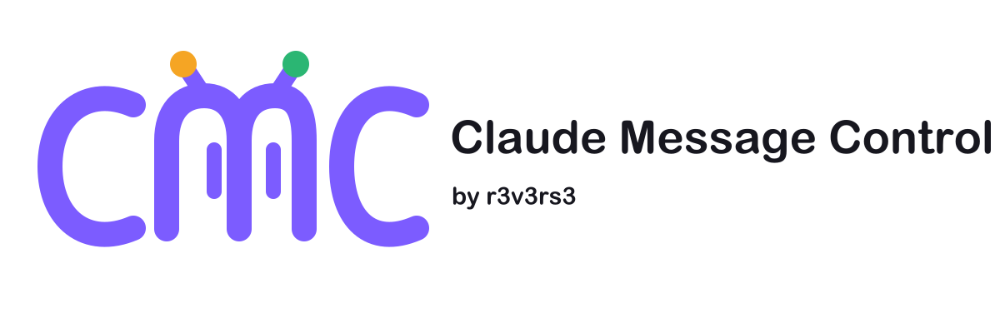

# cmc — Claude Message Control

<!-- Logo: when plugins/cmc/assets/logo-dark.png and logo-light.png exist (brief in senzu/design-system/cmc/logos/brief.md),
     replace the block below with:
<picture>
  <source media="(prefers-color-scheme: dark)" srcset="plugins/cmc/assets/logo-dark.png">
  
</picture>
-->
```
▄▀▀ █▀▄▀█ ▄▀▀   Claude Message Control
▀▄▄ █ ▀ █ ▀▄▄   by r3v3rs3
```

A Claude Code plugin that lets you decide **when** your messages reach the agent: hold what you type while it
works, and release it when you want, without interrupting the turn. It can also hand a task to a second agent that
works in parallel, in its own git worktree, and bring its result back to you.

Version 1.0.0 · MIT license · see [CHANGELOG.md](CHANGELOG.md).

## Requirements

- Claude Code 2.1.330 or newer
- Node.js 22.18 or newer. The plugin is written in TypeScript and Node runs the `.ts` files directly: there is
  no build step and nothing to install besides the plugin folder (no runtime npm dependencies)

## Install

This repository is a Claude Code marketplace (`r3v3rs3`) that holds the plugin in `plugins/cmc`. Add the
marketplace, then install the plugin from it:

```
/plugin marketplace add /path/to/this/repository
/plugin install cmc@r3v3rs3
```

The same from a terminal: `claude plugin marketplace add /path/to/this/repository` and
`claude plugin install cmc@r3v3rs3`. Add `--scope project` to both to enable it for one project only (it is written
to that project's `.claude/settings.json`). Only `plugins/cmc` is installed; the rest of the repository (tests,
development notes) stays out.

To try it from a checkout without installing: `claude --plugin-dir /path/to/this/repository/plugins/cmc`.

Update and remove:

```
claude plugin marketplace update r3v3rs3 && claude plugin update cmc@r3v3rs3   # held messages and settings are kept
claude plugin uninstall cmc@r3v3rs3              # also deletes held messages and settings; add --keep-data to keep them
claude plugin marketplace remove r3v3rs3
```

## Use

| You type | What happens |
|---|---|
| `;; also update the README` | The message is **held**. The agent does not see it and keeps working. You get the receipt `Held (1 queued)`. |
| `/cmc:release` | Every held message is handed to the agent, in delivery order. |
| `;;now` | If the agent is idle, hands everything over **now**: it starts a turn with them. If it is working, they are handed over when its turn ends, like `;;end` (see below). |
| `;;now 2` · `;;now 1 3` | Same, but only those messages. The rest stay held. |
| `;;end` | The held messages are handed over automatically when the current turn ends. One-shot. |
| `;;end 2` | Same, but only those messages. |

### Managing what is held

Control words are typed right after the prefix, with no space. The plugin answers them itself: the agent
never sees them, they cost no tokens, and they work while the agent is busy.

| You type | What happens |
|---|---|
| `;;list` | Shows the held messages in the order they will be delivered, with position, time and id. |
| `;;edit 2 new text` | Replaces the text of message 2. |
| `;;rm 2` · `;;rm 1 3` | Deletes messages. |
| `;;clear` | Deletes every held message. |
| `;;move 3 1` | Moves message 3 to position 1. |
| `;;up 2` · `;;down 2` | Moves message 2 one place. |
| `;;top 3` · `;;bottom 1` | Makes a message the first or the last to be delivered. |
| `;;help` | Lists the control words. |

The order you see in `;;list` is exactly the order of delivery. `/cmc:queue` shows the same list, but as a
slash command it goes through the agent, which then sees your held messages (still held); prefer `;;list`.

### From another terminal

Open a second terminal **in the folder where the Claude Code session was started** (a subfolder works too)
and use the `cmc` command line. Nothing you do there shows up in the session until you release it.

Where the `cmc` command is:

- **Installed from the marketplace**, it is in Claude Code's plugin cache, under a folder named after the version:
  `node ~/.claude/plugins/cache/r3v3rs3/cmc/1.0.0/bin/cmc.ts list`. The path changes when the plugin is updated, so
  an alias is handy, e.g. `alias cmc='node ~/.claude/plugins/cache/r3v3rs3/cmc/1.0.0/bin/cmc.ts'`.
- **From a checkout**: `node /path/to/this/repository/plugins/cmc/bin/cmc.ts list`, or `npm link` in the repository
  to put `cmc` on your PATH.
- Inside Claude Code the plugin's `bin/` is on the agent's PATH, so the agent itself can run `cmc …`.

```
cmc hold also update the README
cmc list
```

| Command | What it does |
|---|---|
| `cmc hold <text>` | Holds a message, like `;; text` in the session. |
| `cmc list` · `edit` · `rm` · `clear` · `move` · `up` · `down` · `top` · `bottom` | The same as the control words. |
| `cmc release [N…]` | Hands messages (all, or those) to the agent when its turn ends. |
| `cmc sessions [--all]` | Shows the open sessions started in this folder, or every session cmc knows. |

If no session is open in the folder, `cmc` says so and stores nothing. If several are, it lists them and you
pick one with `--session <id>` (the first characters of the id are enough).

Why nothing is handed over in the middle of a turn: an earlier version did it, and the agent received the text
between two steps, but the model set it aside as "not part of my task" more than half the time, and by then the
message had left the queue. Handing messages over when a turn ends, or as a new turn when the agent is idle,
worked every time. So cmc only does that: `;;now` and `cmc release` wait for the end of the turn while the agent
is working. If you press Esc to interrupt the agent, cmc may still think it is working; type `/cmc:release`.

### Dispatching to a second agent

Type `>>` followed by a task to hand it to a second agent that works in parallel. The agent of the session does not
see it and is not interrupted.

| You type | What happens |
|---|---|
| `>> review the tests of module X` | A second agent starts on that task. It forks this conversation, so it knows everything said so far. |
| `>> --pack review the tests` | Same, but it gets a short summary of the conversation instead of all of it (cheaper on long sessions). |
| `;;dispatch 2` · `;;dispatch 2 --pack` | Hands held message 2 to a second agent instead of the session. It leaves the queue once the agent has started. |
| `;;agents` | Lists the dispatched agents: id, state, how long they ran, where they work, task. |
| `;;log 1a2b` | What agent `1a2b…` was asked and its latest steps, or its final answer once it has ended. |
| `;;cancel 1a2b` | Stops it. |

When the agent ends, **its result comes back to the queue** as a held message, listed as `(from agent 1a2b…)`: what it
was asked, where its changes are and its final answer, or why it failed and where its log is. You decide when the
session sees it, like any held message (`/cmc:release`, `;;end`, `;;rm`…). When released, it is labelled as the other
agent's report, not as something you typed. A cancelled agent leaves nothing.

Add `--auto` (`>> --auto task`, `;;dispatch 2 --auto`) to have the result handed to the session by itself when one of
its turns ends. If the session is idle when the agent finishes, the result arrives at the end of the next turn.

The command line has the same: `cmc dispatch [--pack] [--auto] <task>`, `cmc agents`, `cmc log <id>`, `cmc cancel <id>`.
`/cmc:agents` shows the list through the agent of the session; `;;agents` keeps it to yourself.

Where it works:

- **In a git repository** the agent gets its own worktree (`.claude/worktrees/cmc-<id>`, branch `worktree-cmc-<id>`),
  so it never edits the files the session is working on. When it ends, a worktree with changes is kept for you to
  review and merge; one without changes is removed with its branch. Add `.claude/worktrees/` to your `.gitignore`.
- **Outside git** there is no worktree: the agent works in the same folder, and the receipt says so.

Its permissions are limited: `acceptEdits`, and only the built-in tools `Read`, `Glob`, `Grep`, `Edit`, `Write` (no shell,
no web), whatever your project or user settings allow. Tools from MCP servers are not covered by that limit. Restricting
the tools changes the agent's prompt, so a fork cannot reuse the session's prompt cache and costs noticeably more;
`"restrictTools": false` in the settings trades the limit for the lower cost (the tools are then only pre-approved).

It runs with your own Claude Code setup, so your other plugins and hooks run in it too. If some of them write files
(memory, notes), they write them in the agent's worktree, which then always counts as changed and is kept.

### Settings

Everything works without settings. To change something, write the file with every setting at its default and edit
it; changes apply from the next prompt:

```
cmc config init      # writes config.json in the plugin data directory, and says where
cmc config           # shows the settings in force, and any problem in the file
```

```json
{
  "holdPrefix": ";;",
  "dispatchPrefix": ">>",
  "dispatch": {
    "context": "fork",
    "return": "held",
    "permissionMode": "acceptEdits",
    "tools": ["Read", "Glob", "Grep", "Edit", "Write"],
    "restrictTools": true
  },
  "retentionDays": 30
}
```

| Setting | Values |
|---|---|
| `holdPrefix`, `dispatchPrefix` | 1 to 4 symbols, no letters, digits, spaces or `/`; one cannot start the other. |
| `dispatch.context` | `fork` (the whole conversation) or `pack` (a short summary). `--pack` / `--fork` override it per dispatch. |
| `dispatch.return` | `held` (the result waits in the queue) or `auto` (handed over at the end of a turn). `--auto` / `--held` override it. |
| `dispatch.permissionMode` | `acceptEdits`, `default` or `plan`. `bypassPermissions` is never accepted. |
| `dispatch.tools` | Tools the dispatched agent may use, as `--allowedTools` takes them, e.g. `"Bash(npm test:*)"` (no commas inside a rule). |
| `dispatch.restrictTools` | `true`: the agent has only those built-in tools. `false`: they are only pre-approved, and the fork is cheaper. |
| `retentionDays` | Sessions inactive for longer are deleted with their queue. `0` keeps them forever. |

A wrong value never stops the plugin: that setting falls back to its default, and the problem is shown when the next
session starts and in `cmc config`.

### Indicator

While something is held or a dispatched agent is working, `✉ 2 held · ⚙ 1 agent` is pinned under the prompt. It follows the queue within about a second,
whoever changes it (the session or the `cmc` command line), and disappears when the queue is empty.

Things worth knowing:

- A message is held when it **starts** with `;;`. Anything else goes to the agent as usual.
- Put a space after the prefix to hold a message: `;; clear the cache` is held, `;;clear` empties the queue.
  Text that merely starts like a control word (`;;list the files`) is held as a message.
- Claude Code prints a three-line notice ("UserPromptSubmit operation blocked by hook…") for every held
  message. That notice is the receipt: the agent does not see it.
- While the agent is busy, Claude Code hands your message to the plugin when the tool that is running
  finishes, so the receipt shows up a moment after you press Enter.
- `/cmc:release` typed while the agent is busy takes effect when the turn ends, because Claude Code does not
  run slash commands in the middle of a turn. To get the same result without waiting at the keyboard, type
  `;;end`.
- Held messages belong to the session they were typed in and are stored on your machine, under the plugin
  data directory (`~/.claude/plugins/data/…/sessions/<session id>/queue.jsonl`).
- The queue survives closing the terminal: resume the session (`claude --resume <id>`, or `--continue`) and the
  held messages are still there; cmc reminds you how many. A compaction does not touch them. Sessions left
  inactive for more than 30 days are cleaned up, with whatever they still held.
- If the plugin itself fails, your prompt goes to the agent as if the plugin were not installed, and the
  error is written to `cmc.log` in the data directory. A message is never dropped silently.

## Known limits

- **Terminal only.** Plugins installed from a repository do not reach Claude Code on the web (cloud sessions), so cmc
  does not work there. The desktop app's Code tab loads plugins in local sessions but has not been tested.
- **No delivery in the middle of a turn**, on purpose (see above). If you interrupt the agent with Esc, cmc may still
  think it is working, and `;;now` then waits for the end of the next turn; `/cmc:release` works in that case.
- **`--continue` and dispatched agents.** `claude --continue` resumes the most recent conversation in the folder. A
  dispatched agent that worked in the same folder (no git, so no worktree) is more recent; use `claude --resume <id>`.
- **Dispatched agents count as sessions.** If cmc is installed for your user, a dispatched agent loads it too, and
  while it runs `cmc` from another terminal sees two sessions in the folder and asks for `--session`.
- **Held-message notices.** Claude Code prints its own three-line notice for every held message; cmc cannot change it.
- **Tested on Windows 11** with Claude Code 2.1.330 and Node 24. It is written for macOS and Linux too (paths, file
  modes, process handling), but the test suite has not been run there yet. Node 22.18 is the documented minimum for
  running `.ts` files; it was not tested on that exact version.
- **Model behaviour.** What the agent does with released text is up to the model. Released messages and agent reports
  are labelled for what they are, and in every test so far the agent acted on them as expected.

## Security

cmc works only on your machine: no network calls, no runtime dependencies. Held messages, logs and agent outputs are
stored in the plugin data directory, readable by your user only (on macOS and Linux). Text the plugin quotes from the
session transcript or from another agent is labelled and fenced, and the dispatched agent never runs with
`bypassPermissions`. The review that checked this is in `senzu/seguridad/` in the repository.

## Development

```
npm test        # node --test
npm install     # development only: TypeScript and the Node type definitions
npm run types   # tsc --noEmit, strict
npm run lint    # syntax check of every module
claude plugin validate .              # the marketplace
claude plugin validate ./plugins/cmc  # the plugin
```

`node scripts/e2e.ts` drives a real headless Claude Code session with this checkout loaded and types
messages into it while it works (it spends tokens, so it is not part of `npm test`). `--project <dir> --installed`
runs it in a folder where the plugin was installed from the marketplace. See
[docs/manual-test.md](docs/manual-test.md) for the scenarios and for the checks that need the interactive
terminal.

## Author

Peterson Sena (r3v3rs3)
